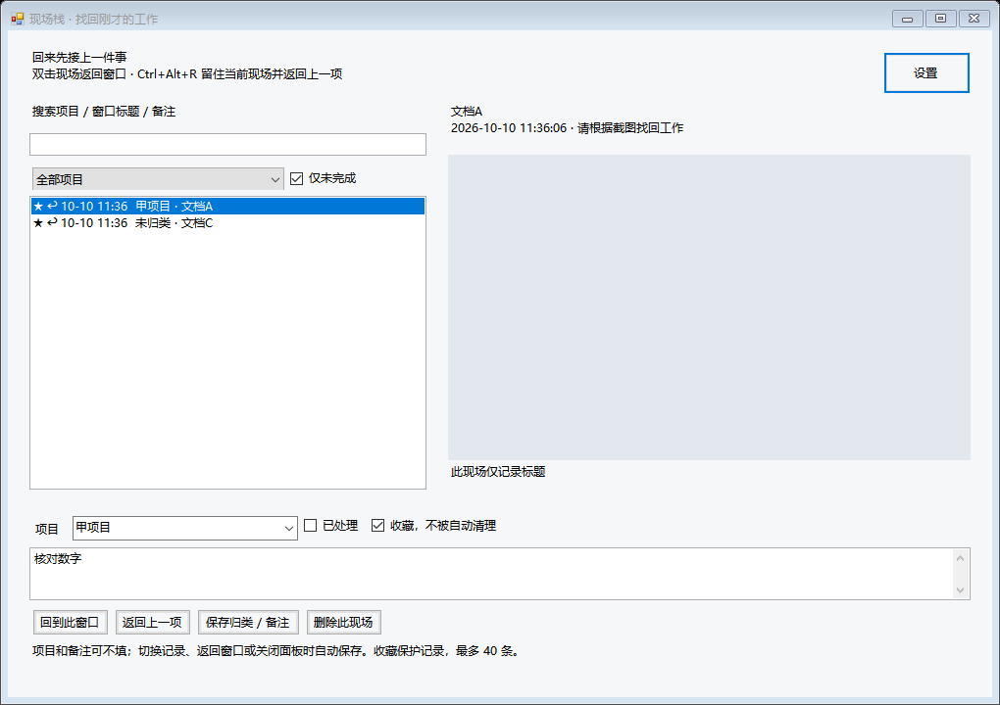
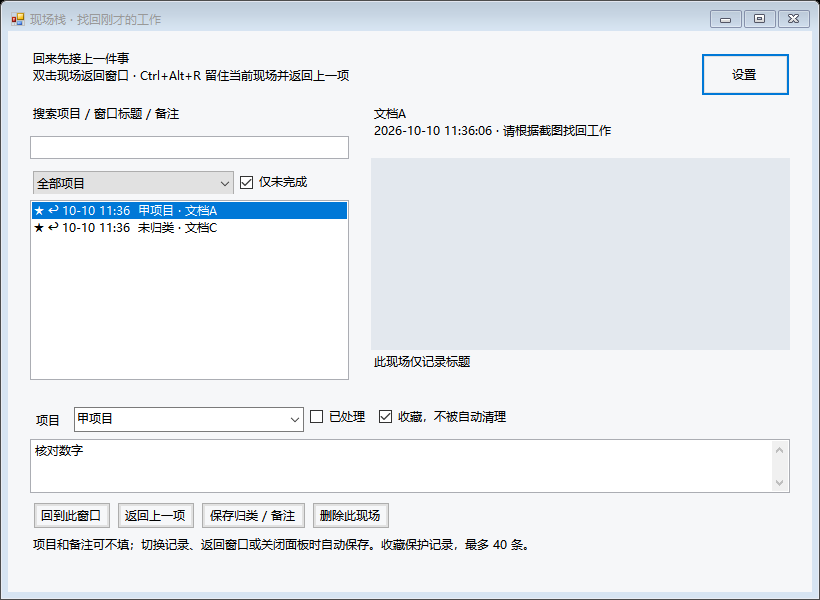

# 现场栈 · Scene Stack

一个为多项目切换设计的轻量 Windows 桌面挂件。突然要回消息、赶另一份文档或去打印时，一键留下当前工作现场，回来后快速接上。

**无需账号，不联网，不调用云端 API。** 记录只在本机保存，不持续录屏，不做 OCR，也不在后台扫描窗口或文件。



## 快速使用

1. 下载仓库中的 [`现场栈.exe`](现场栈.exe)，双击运行。挂件出现在屏幕边缘，托盘也会显示图标。
2. 在 WPS、聊天窗口等工作窗口里，按 **Ctrl+Alt+空格** 留下标题和截图，不必拖文件或输入文字。
3. 回来按 **Ctrl+Alt+B** 查看现场栈，双击某条记录返回仍打开的原窗口。
4. 按 **Ctrl+Alt+R**，先记录当前窗口，再返回最近一个仍打开的未完成现场；可在两项工作之间来回切换。

例如：项目 A 写文档 → 留现场 → 项目 B 回消息 → 留现场 → 项目 C 紧急文档 → 留现场 → 去打印。回来打开现场栈，先接 C，再根据项目筛选找到 A 或 B。

## 挂件和快捷键

| 操作 | 功能 |
| --- | --- |
| Ctrl+Alt+空格 / 单击挂件 | 记录当前前台窗口 |
| Ctrl+Alt+B / 右键挂件 | 打开现场栈 |
| Ctrl+Alt+R / 中键挂件 | 留下当前工作，返回上一项 |
| 拖动挂件 | 调整位置，退出后仍保留 |
| 双击现场 / 列表中按 Enter | 返回对应窗口 |
| Ctrl+F | 聚焦面板搜索框 |
| Esc | 保存并收起面板 |

设置中可将快捷键组切换为 **Ctrl+Shift**。快捷键冲突时会提示，也可继续使用挂件。挂件数字表示未完成数量，记录成功时短暂变绿。

## 功能

- **中断现场栈**：最近一次记录排在最上面，默认只显示未完成事项。
- **重复记录合并**：同一进程、同一窗口、相同标题的未完成现场再次记录时，更新截图和时间，保留项目、备注和收藏。
- **项目归类记忆**：手动归类后，相同标题的新记录沿用最近一次项目名；不同标题不自动猜测。
- **项目筛选与搜索**：按项目、标题或备注查找，支持组合筛选。
- **备注自动保存**：切换记录、筛选、返回窗口、关闭面板或正常退出时保存编辑内容。
- **收藏保护**：收藏不会被数量限制自动删除。最多保留 40 条，优先清理最旧的已完成且未收藏记录，再清理最旧的未收藏记录。全部收藏时提示腾出位置。
- **只留标题模式**：可关闭之后的截图记录，减少处理和磁盘开销。
- **图片按需加载**：预览面板隐藏或关闭时释放图片。
- **旧记录兼容**：能够读取第一版的 XML 数据。

## 运行环境与资源

- Windows 桌面环境，使用系统提供的 .NET Framework 4.x、Windows Forms 和 Win32 窗口接口。
- 无需安装第三方运行库，无浏览器内核或 AI 模型。
- 当前 EXE 约 **28 KB**；本机短时启动测得空闲工作集约 **32 MB**，连续 3 秒空闲观察 CPU 时间增量为 **0 ms**。
- 打开大截图时内存会增加，实际占用随系统和使用情况变化。

## 数据与功能边界

本地数据位于 `%LOCALAPPDATA%\SceneStack`，包含 `scenes.xml`、`settings.xml` 和 JPG 截图。退出后保留。可在面板删除单条现场；如需清空全部记录，先退出程序，再删除数据目录。

截图只记录前台窗口在屏幕上的可见部分。挂件会在截图时短暂隐藏；其他覆盖窗口仍可能被拍到。程序不会捕捉被遮挡的正文、滚动区域外的内容或受保护画面。

**现场记录不等于文档保存。** 程序不保存 WPS 文档、不恢复未保存的修改或光标，也不拦截其他程序的关闭按钮。原窗口关闭或标题改变后，需要根据截图和标题手动找回文档，不会自动重新打开文件。Windows 可能拒绝前台切换，此时会提示。

项目关联依据窗口标题。像“WPS云盘”这样的通用标题可能对应不同业务，必要时手动修改项目归类。只留标题设置不会立即清除已有截图；再次记录同一未完成窗口时，会更新原现场。

## 从源码构建

在仓库目录中打开 PowerShell：

```powershell
.\build.ps1
```

输出为 `build\现场栈.exe`。脚本使用 Windows 自带的 64 位 .NET Framework 编译器，不需下载依赖。若系统缺少对应编译器，需要先提供兼容的 .NET Framework 开发环境。

更新运行中的版本时，先在托盘正常退出，再替换可执行文件并重新启动。

## 验证

```powershell
.\build.ps1 -Test
```

目前包含 **29 项检查**：旧 XML 兼容、项目和备注筛选、完成及收藏处理、重复合并、磁盘保存、40 条上限、自动保存备注、48×48 挂件尺寸，以及两个独立测试窗口的真实截图和双向返回。正常尺寸与最小尺寸面板均已渲染检查。

测试使用独立临时数据目录，不改动你的现场记录；运行时会短暂显示两个测试窗口，并生成界面预览。窗口切换测试需要可交互的 Windows 桌面，会受系统前台切换规则影响。尚未完成所有 WPS 文档与聊天应用的完整工作流验收。

## 文件结构

| 文件 | 内容 |
| --- | --- |
| `SceneStack.cs` | 挂件、截图记录、窗口返回、项目管理和设置 |
| `Tests.cs` | 逻辑、保存与实际窗口检查 |
| `build.ps1` | 本地编译与测试入口 |
| `现场栈.exe` | 可直接运行的程序 |
| `界面预览.png` / `紧凑界面预览.png` | 测试数据生成的面板预览 |
| `使用说明.md` | 详细中文操作说明 |


